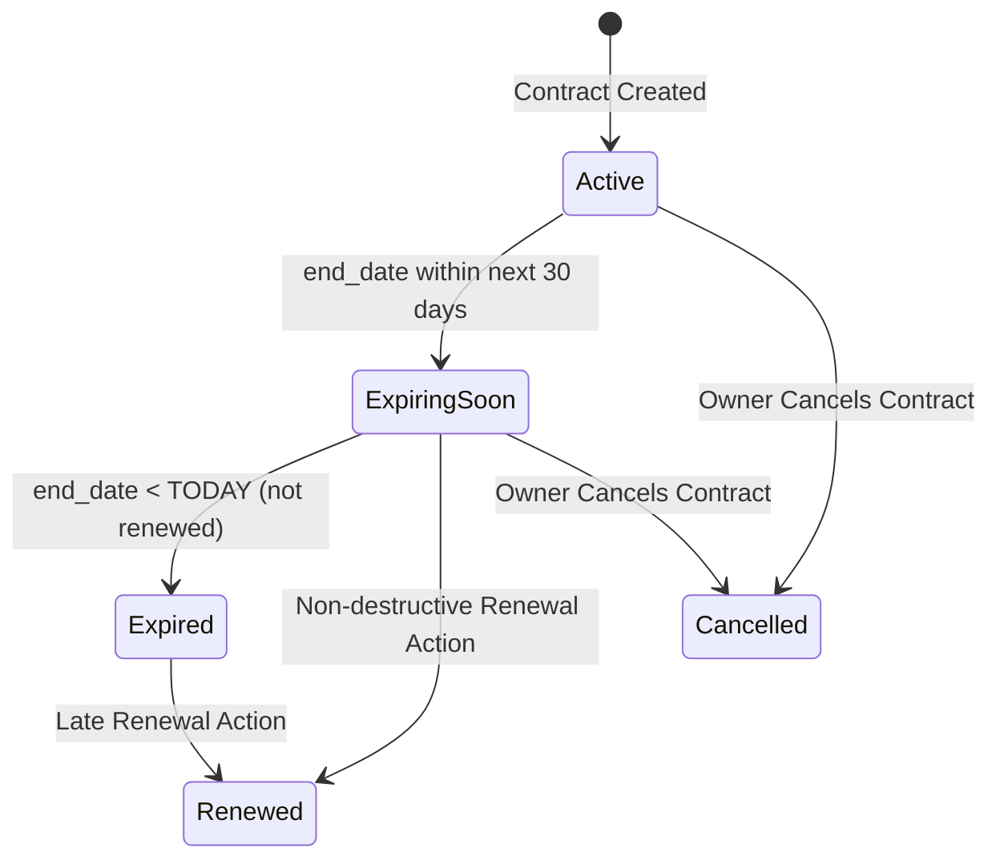

# Yaadibook — AMC (Annual Maintenance Contract) Management

## 1. Overview & Purpose

In India, Annual Maintenance Contracts (AMCs) represent the primary source of predictable, high-margin recurring revenue for local service businesses — including RO water purifier installers, air conditioning technicians, CCTV security installers, generator service providers, and electrical/appliance contractors.

The **AMC Management** module in Yaadibook allows small-business owners to:
1. Create and maintain formal AMC records linked to customers and optional equipment.
2. Track contract validity periods, contract amounts, and payment statuses.
3. Automatically monitor upcoming contract expirations (expiring within 30 days) and expired contracts.
4. Execute non-destructive contract renewals, preserving full contract audit history over multiple years.
5. Reach out directly to customers via one-tap phone call or pre-filled WhatsApp renewal reminders.
6. Seamlessly link AMC contracts to future maintenance visit schedules.

---

## 2. AMC Data Model & Lifecycle

### Database Entity: `public.amc_contracts`

| Column | Type | Description |
|:---|:---|:---|
| `id` | `UUID PK` | Primary key |
| `business_id` | `UUID FK` | Multi-tenant isolation to business owner |
| `customer_id` | `UUID FK` | Mandatory customer reference |
| `equipment_id` | `UUID FK NULL` | Optional customer asset reference |
| `contract_number` | `TEXT` | Human-friendly serial: `AMC-YYYYMM-XXXX` |
| `plan_name` | `TEXT` | Contract or plan title (e.g., "Comprehensive AC Annual Package") |
| `start_date` | `DATE` | Effective coverage start date |
| `end_date` | `DATE` | Coverage expiry date |
| `amount` | `NUMERIC(10,2)` | Contract value in INR (₹) |
| `payment_status` | `TEXT` | `pending`, `partial`, `paid` |
| `terms_conditions` | `TEXT NULL` | Coverage terms, number of free visits, spare inclusions |
| `notes` | `TEXT NULL` | Internal business owner notes |
| `status` | `TEXT` | `active`, `expiring`, `expired`, `renewed`, `cancelled` |
| `renewed_from_contract_id` | `UUID FK NULL` | Points to predecessor contract when renewed |
| `renewed_to_contract_id` | `UUID FK NULL` | Points to successor contract once renewed |
| `created_at` / `updated_at` | `TIMESTAMPTZ` | Timestamp audit records |

---

### Dynamic Contract Validity Derivation

While `status` in the database stores explicit operational states (`active`, `renewed`, `cancelled`), the runtime application calculates **effective status** dynamically against the current date:

1. **Active**: `status = 'active'` AND `end_date > TODAY + 30 days`.
2. **Expiring Soon**: `status = 'active'` AND `end_date >= TODAY` AND `end_date <= TODAY + 30 days`.
3. **Expired**: `status = 'active'` AND `end_date < TODAY`.
4. **Renewed**: Explicitly marked `renewed` when succeeded by a new contract.
5. **Cancelled**: Explicitly marked `cancelled` by the owner.

---

## 3. Strict Non-Destructive Renewal Architecture

A fundamental architectural rule of Yaadibook is:
> **Never overwrite or delete an existing AMC contract during renewal.**

When an AMC expires or is renewed:
1. The existing contract is preserved intact with all original dates, amounts, and audit notes.
2. A **brand new contract** is created in `public.amc_contracts` with a new sequential contract number.
3. The old contract's `status` is transitioned to `'renewed'` and its `renewed_to_contract_id` points to the new contract.
4. The new contract's `renewed_from_contract_id` references the old contract.
5. This creates an unbroken multi-year renewal chain for every customer asset.

This operation is executed atomically either via the Supabase stored procedure `renew_amc_contract` or the repository layer.

---

## 4. User Experience & Screen Inventory

### 1. AMC Overview Screen (`/amc`)
- **Metric Header**:
  - Active Contracts
  - Expiring Soon (highlighted in Warning Amber)
  - Expired (highlighted in Alert Red)
  - Renewed Contracts
- **Status Filter Chips**: All, Active, Expiring, Expired, Renewed, Cancelled.
- **Search Bar**: Instant filter by contract number or customer name.
- **Contract Cards**:
  - Contract number and plan name.
  - Customer name and phone.
  - Coverage dates (Start → End) with remaining days countdown.
  - Amount in formatted INR (e.g. ₹4,500.00) and payment status badge (`Paid`, `Pending`).
  - Direct actions: Call, WhatsApp, View Details.
- **Floating Action Button**: "+ Create AMC" (`/amc/create`).

### 2. Create AMC Screen (`/amc/create`)
- Supports pre-filling customer via query parameter `?customerId=...`.
- Customer selector with searchable bottom sheet.
- Optional equipment selector filtered to selected customer.
- Plan name field with common Indian service presets ("Standard Annual Service", "Comprehensive Coverage", "Filter Replacement Plan").
- Start date picker (defaults to Today).
- Duration selector: 1 Year (default), 2 Years, 6 Months, or Custom Date.
- Contract amount (₹) and payment status selector (`pending`, `partial`, `paid`).
- Coverage terms and internal notes.

### 3. AMC Detail Screen (`/amc/:id`)
- Prominent status banner (e.g., "Expires in 12 days" or "Contract Expired").
- One-tap Customer Contact Card (Phone Call & WhatsApp).
- Linked Equipment asset card.
- Detailed coverage dates and timeline.
- Financial details: Contract amount and payment status.
- Terms & Conditions section.
- **Renewal History Link**: If contract was renewed, displays direct link to previous or successor contract.
- Primary Action Buttons:
  - **Renew Contract** (`/amc/:id/renew`) — prominent when expiring or expired.
  - **Schedule Maintenance** (`/maintenance/add?customerId=...`) — direct bridge to maintenance visits.
  - **Edit Contract** (`/amc/:id/edit`).

### 4. Edit AMC Screen (`/amc/:id/edit`)
- Update plan name, dates, amount, payment status, terms, and notes.
- Customer and equipment remain immutable to safeguard data integrity.

### 5. Renew AMC Screen (`/amc/:id/renew`)
- Pre-fills all customer and equipment information from previous contract.
- New start date defaults to `previous_end_date + 1 day`.
- Duration defaults to 1 year from new start date.
- Option to adjust contract price and terms for the new term.
- Atomically creates new contract and updates old contract to `renewed`.

---

## 5. Cross-Module Integrations

1. **Today Dashboard**:
   - The metric counter card "Expiring AMCs" links directly to `/amc?status=expiring`.
2. **Quick Add Sheet**:
   - The "Create AMC" action item opens `/amc/create`.
3. **Customer Detail Screen**:
   - Dedicated "AMC Contracts" section displays all active and past contracts for the customer.
   - "+ Add Contract" shortcut pre-selects the customer ID.
4. **Service Detail Screen**:
   - "Future Actions & Contracts" card offers a direct shortcut to create an AMC contract for the customer following an installation or major repair.
5. **Settings ("More" Tab)**:
   - Dedicated "AMC Management" navigation tile under Business Operations.

