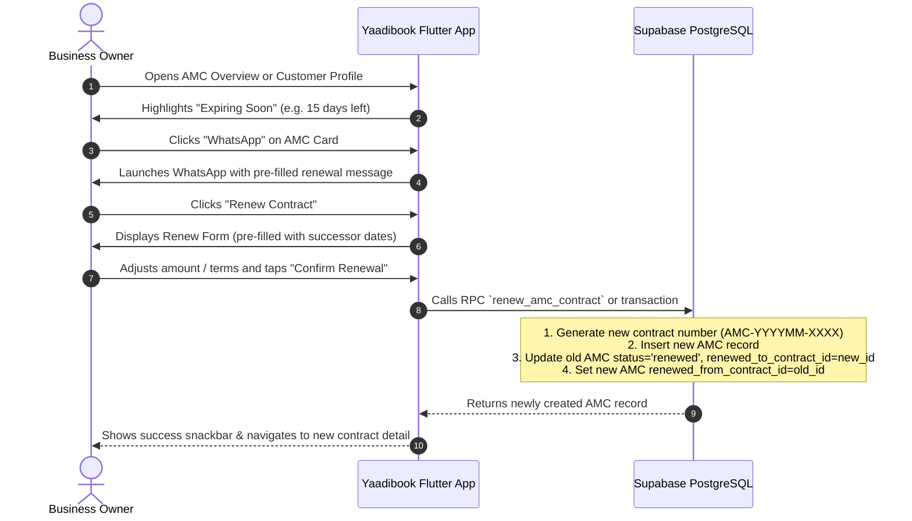

# Yaadibook — AMC Renewal Workflow & Audit Specification

## 1. Context & Business Rationale

In small-business service industries in India, an AMC (Annual Maintenance Contract) represents a legal and financial contract between the business owner and the customer for a defined period of time (typically 12 months).

When a contract reaches its expiration date, businesses commonly negotiate renewals. Crucially:
1. Historical financial reports must reflect what was billed and collected during year 1, year 2, etc.
2. Past contract terms, coverage limits, and visit frequencies must not be lost or altered.
3. The business owner must be able to see the customer's loyalty history across multiple years.

Therefore, Yaadibook enforces **non-destructive contract renewal**: an expired or expiring contract is never modified in-place to extend its dates. Instead, a new contract record is created, and the two are linked in an explicit predecessor/successor audit chain.

---

## 2. Renewal State Flow & Sequence



---

## 3. Data Integrity & Database Architecture

### Two-Way Audit Pointers

Both sides of the renewal relationship maintain explicit pointers:

```
+------------------------------------+          +------------------------------------+
|       Prior Year AMC (Old)         |          |       Current Year AMC (New)       |
|  - id: "uuid-1"                    |          |  - id: "uuid-2"                    |
|  - contract_number: "AMC-202501-1" |          |  - contract_number: "AMC-202601-4" |
|  - status: 'renewed'               |          |  - status: 'active'                |
|  - renewed_to_contract_id: "uuid-2"|--------->|  - renewed_from_contract_id:"uuid-1|
+------------------------------------+          +------------------------------------+
```

### PostgreSQL Stored Procedure: `renew_amc_contract`

To guarantee atomic execution even in unstable mobile network environments, the renewal logic is encapsulated in a PostgreSQL database function:

```sql
CREATE OR REPLACE FUNCTION public.renew_amc_contract(
    p_old_contract_id UUID,
    p_new_start_date DATE,
    p_new_end_date DATE,
    p_new_amount NUMERIC(10,2),
    p_new_payment_status TEXT DEFAULT 'pending',
    p_new_terms TEXT DEFAULT NULL,
    p_new_notes TEXT DEFAULT NULL
)
RETURNS UUID
LANGUAGE plpgsql
SECURITY DEFINER
AS $$
DECLARE
    v_old RECORD;
    v_new_id UUID;
    v_new_contract_number TEXT;
BEGIN
    -- 1. Fetch and validate old contract
    SELECT * INTO v_old FROM public.amc_contracts WHERE id = p_old_contract_id;
    IF NOT FOUND THEN
        RAISE EXCEPTION 'Contract % not found', p_old_contract_id;
    END IF;

    -- 2. Generate new sequential contract number
    v_new_contract_number := public.next_amc_contract_number(v_old.business_id);

    -- 3. Insert new successor contract
    INSERT INTO public.amc_contracts (
        business_id,
        customer_id,
        equipment_id,
        contract_number,
        plan_name,
        start_date,
        end_date,
        amount,
        payment_status,
        terms_conditions,
        notes,
        status,
        renewed_from_contract_id
    ) VALUES (
        v_old.business_id,
        v_old.customer_id,
        v_old.equipment_id,
        v_new_contract_number,
        v_old.plan_name,
        p_new_start_date,
        p_new_end_date,
        p_new_amount,
        p_new_payment_status,
        COALESCE(p_new_terms, v_old.terms_conditions),
        COALESCE(p_new_notes, v_old.notes),
        'active',
        p_old_contract_id
    ) RETURNING id INTO v_new_id;

    -- 4. Mark old contract as renewed
    UPDATE public.amc_contracts
    SET status = 'renewed',
        renewed_to_contract_id = v_new_id,
        updated_at = NOW()
    WHERE id = p_old_contract_id;

    RETURN v_new_id;
END;
$$;
```

---

## 4. UI Rules & Form Defaults

When opening the **Renew AMC Screen** (`/amc/:id/renew`):

1. **Start Date Defaulting**:
   - If old contract has not expired yet: `new_start_date = old_contract.end_date + 1 day`.
   - If old contract expired in the past: default to `TODAY` (or allow the owner to select continuous backdated start if agreed with customer).
2. **End Date Defaulting**:
   - Automatically computed as `new_start_date + 1 year - 1 day` (e.g. 01/01/2026 to 31/12/2026).
3. **Amount & Terms**:
   - Pre-populated with the previous contract's value and terms for fast one-tap renewal, while remaining fully editable if prices have increased.
4. **Customer & Equipment**:
   - Strictly locked and displayed as read-only metadata badges to prevent accidental reassignment.

---

## 5. Customer Notification Template

Yaadibook generates localized WhatsApp messages when an owner taps the WhatsApp action on an expiring contract:

- **English**:
  > *"Dear [Customer Name], your AMC for [Plan Name] with [Business Name] is expiring on [End Date]. Please let us know to confirm your renewal for uninterrupted service. Thank you!"*
- **Gujarati**:
  > *"નમસ્તે [Customer Name], [Business Name] સાથેનો તમારો [Plan Name] માટેનો AMC કરાર [End Date] ના રોજ પૂર્ણ થઈ રહ્યો છે. સેવા ચાલુ રાખવા માટે કૃપા કરીને રિન્યૂ કરાવવા સંપર્ક કરો. આભાર!"*
- **Hindi**:
  > *"नमस्ते [Customer Name], [Business Name] के साथ आपका [Plan Name] AMC अनुबंध [End Date] को समाप्त हो रहा है। निरंतर सेवा के लिए कृपया नवीनीकरण हेतु संपर्क करें। धन्यवाद!"*

