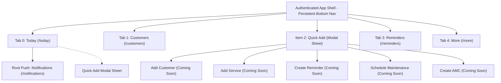

# Yaadibook — App Shell & Navigation Specification

## 1. Overview & Architecture

Yaadibook's authenticated interface implements a persistent, mobile-first bottom navigation shell utilizing GoRouter's `StatefulShellRoute.indexedStack`. This ensures that screen state, scroll positions, and form inputs are preserved when navigating between tabs.

The central action (**Add**) uses an action-interception pattern to present a polished modal bottom sheet without switching screen branches or forcing an unnecessary route transition.

---

## 2. Navigation Architecture Diagram

---

## 3. Persistent Destinations

The bottom navigation bar features five accessible destinations adhering to mobile accessibility guidelines with touch targets $\ge 48\text{px}$:

| Destination Index | Label | Active Route | Icon (Normal / Selected) | Behavior |
| :--- | :--- | :--- | :--- | :--- |
| **0** | `Today` | `/today` | `today_outlined` / `today` | Switches to Branch 0 (Daily action center). |
| **1** | `Customers` | `/customers` | `people_outline` / `people` | Switches to Branch 1 (Customer directory). |
| **2** | `Add` | *Modal Sheet* | `add_circle_outline` / `add_circle` | **Intercepted**: Opens `QuickAddSheet` modal bottom sheet. Preserves active tab branch. |
| **3** | `Reminders` | `/reminders` | `notifications_none_outlined` / `notifications` | Switches to Branch 2 (Reminders & follow-ups). |
| **4** | `More` | `/more` | `more_horiz_outlined` / `more_horiz` | Switches to Branch 3 (Settings & business management). |

---

## 4. Modal Bottom Sheet: Quick Add (`QuickAddSheet`)

Tapping the center **Add** button summons `QuickAddSheet`:
- **Title**: *"What would you like to add?"*
- **Layout**: Bottom sheet with drag handle, close button, and standard 24px top border radius.
- **Actions**:
  1. `Add Customer` — "Create a new customer profile"
  2. `Add Service` — "Record a completed or scheduled service"
  3. `Create Reminder` — "Set a reminder or follow-up note"
  4. `Schedule Maintenance` — "Plan a periodic service visit"
  5. `Create AMC` — "Set up an annual maintenance contract"
- **Phase Restriction Handling**: Unimplemented modules display a non-intrusive `Coming Soon` tag and an informative toast message, maintaining zero mock/fake creation. Actions are pre-wired to modular callbacks for immediate activation in Phases 5 & 6.

---

## 5. Notification Centre (`/notifications`)

Accessible via the notification bell icon located in the `DashboardHeader`:
- Pushed to the root navigator (`parentNavigatorKey: _rootNavigatorKey`).
- Displays a clean empty state:
  - *"No new notifications"*
  - *"You're up to date with all your reminders and alerts."*
- Full hardware and software Android back-button support returning directly to `/today`.

---

## 6. Route Protection & Journey Mapping

The navigation flow is governed by `AppRouterNotifier` responding to `onboardingJourneyStatusProvider` and `authStateProvider`:
1. `loading`: `/splash`
2. `unauthenticated`: `/welcome` (with `/login`, `/register`, `/forgot-password`, `/reset-password`)
3. `needsBusiness`: `/onboarding`
4. `completed`: `/today` (and shell routes `/customers`, `/reminders`, `/more`, `/notifications`)

