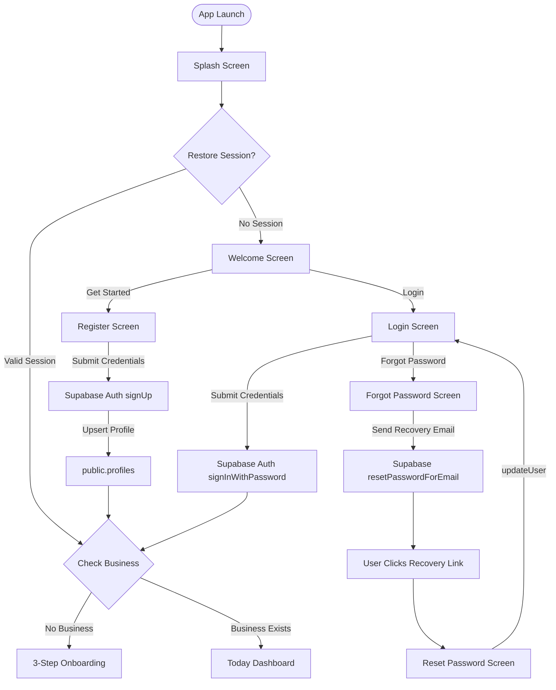

# Yaadibook — Authentication Flow & Architecture

## 1. Overview

Yaadibook's authentication strategy is built directly upon **Supabase Auth**, offering an accessible, secure experience tailored for non-technical small-business owners in India. The application employs email and password credentials for MVP account creation and authentication, with session persistence, password recovery deep links, and trilingual error translation.

---

## 2. Authentication Journey

---

## 3. Screen Specifications

### 3.1 Splash Screen (`/splash`)
- Brand background with green app icon and loading spinner.
- Initiates session restoration and triggers GoRouter guard evaluation.

### 3.2 Welcome Screen (`/welcome`)
- Value proposition: *"Manage your business, the simpler way."*
- Dynamic language switcher dropdown supporting English, ગુજરાતી, and हिन्दी.
- Primary CTA: *"Get Started"* -> routes to `/register`.
- Secondary CTA: *"I already have an account"* -> routes to `/login`.

### 3.3 Registration Screen (`/register`)
- Input fields: Full Name, Email Address, Password, Confirm Password.
- Password visibility toggles.
- Client validation:
  - Required field check.
  - Email format standard check (`^[^@]+@[^@]+\.[^@]+`).
  - Minimum 6 characters for password.
  - Password and confirm password exact match.
- Idempotent profile provisioning in `public.profiles` upon successful user registration.
- Terms and privacy notice.

### 3.4 Login Screen (`/login`)
- Input fields: Email Address, Password.
- Password visibility toggle.
- "Forgot Password?" navigation link.
- Friendly localized error banners (e.g. wrong password, unconfirmed email, network outage).
- Direct switch to Registration screen.

### 3.5 Forgot Password Screen (`/forgot-password`)
- Registered email input.
- Sends Supabase password reset link.
- Upon completion, transitions to an illustrated email confirmation view.

### 3.6 Reset Password Screen (`/reset-password`)
- New Password and Confirm Password inputs.
- Invokes `supabase.auth.updateUser(UserAttributes(password: newPassword))`.
- Upon success, displays confirmation and routes user back to `/login`.

---

## 4. Error Mapping & Localisation

Raw Supabase Auth exceptions are caught by `AuthController` and translated into clear, friendly language without technical jargon:

| Raw Supabase Exception | User-Facing Message | Localized Key |
| :--- | :--- | :--- |
| `invalid_credentials` / `Invalid login credentials` | "Invalid email or password. Please try again." | `authErrorInvalidCredentials` |
| `user_already_exists` / `already registered` | "This email is already registered. Please log in." | `authErrorEmailAlreadyRegistered` |
| `Email not confirmed` | "Please verify your email address before logging in." | `authErrorEmailUnconfirmed` |
| `weak_password` / `< 6 characters` | "Password is too weak. Please choose a stronger password." | `authErrorWeakPassword` |
| `SocketException` / `network` | "Network error. Please check your internet connection." | `authErrorNetwork` |
| `User not found` | "No account found with this email." | `authErrorUserNotFound` |

---

## 5. Security & Session Handling

1. **Zero Secret Exposure**: Only the Supabase `anon` public key is utilized. No `service_role` key is ever included in the mobile client or Git repository.
2. **Session Persistence**: Sessions are automatically persisted locally using `FlutterAuthClientOptions(autoRefreshToken: true)` via Supabase Flutter SDK.
3. **Route Guards**: GoRouter dynamically checks `onboardingJourneyStatusProvider` before rendering any screen, preventing unauthorized access to restricted screens.
