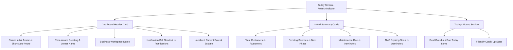

# Yaadibook — Today Dashboard Specification

## 1. Product Objective

The **Today Dashboard** is the daily operational cockpit for Indian service business owners. It serves as an immediate action center rather than an abstract analytics portal. It answers one clear question as soon as the app opens:

> *"What needs my attention right now to run my business smoothly?"*

---

## 2. Dashboard Layout Architecture

---

## 3. Header Specification & Time-Aware Greeting

### A. Greeting Logic
The greeting is dynamically computed from local device time via pure function `getGreetingPeriod(DateTime)`:
- `05:00` to `11:59`: Morning (e.g. *"Good morning, Bharat!"* / *"સુપ્રભાત, ભરત!"* / *"शुभ प्रभात, भरत!"*)
- `12:00` to `16:59`: Afternoon (e.g. *"Good afternoon, Bharat!"* / *"શુભ બપોર, ભરત!"* / *"शुभ दोपहर, भरत!"*)
- `17:00` to `04:59`: Evening (e.g. *"Good evening, Bharat!"* / *"શુભ સાંજ, ભરત!"* / *"शुभ संध्या, भरत!"*)

### B. Header Elements
- **Avatar Shortcut**: Displays the owner's initial. Tapping navigates directly to `/more`.
- **Business Identity**: Displays live business name from `currentBusinessProvider`.
- **Notification Shortcut**: Bell icon with minimum $48\text{px}$ touch target pushing `/notifications`.
- **Date Bar**: Current date formatted using localized `DateFormatter.formatShort`.

---

## 4. Daily Summary Cards (Strict Counting Rules)

Four compact, high-contrast metric cards display real counts queried from Supabase:

| Metric Card | Table Queried | Filtering & Date Rule | Destination Route |
| :--- | :--- | :--- | :--- |
| **Total Customers** | `customers` | `business_id = :id AND archived_at IS NULL` | `/customers` |
| **Pending Services** | `service_entries` | `business_id = :id AND status IN ('pending', 'in_progress')` | `/services/list?status=pending` |
| **Maintenance Due** | `maintenance_occurrences` | `business_id = :id AND status IN ('scheduled', 'due', 'overdue') AND due_date <= CURRENT_DATE` | `/reminders` |
| **AMC Expiring Soon** | `amc_contracts` | `business_id = :id AND status IN ('active', 'expiring') AND end_date BETWEEN CURRENT_DATE AND (CURRENT_DATE + 30 days)` | `/reminders` |

### Edge Case Principles
- If a business has zero records, metrics display a clean `0` rather than false mock figures.
- Completed, cancelled, or archived records are never counted as active work.

---

## 5. "Today's Focus" Task Aggregation

The Today's Focus list combines real activities requiring attention today, sorted by urgency (overdue items first):

1. **Reminders**: Active reminders (`reminders` table) where `due_at <= end of today`.
2. **Maintenance Occurrences**: Scheduled visits (`maintenance_occurrences` table) where `due_date <= today`.
3. **Pending Services**: Active repairs/installations (`service_entries` table) where `service_date <= today`.

### Item Presentation
Each card displays:
- **Source Badge**: `Maintenance` (amber), `AMC` (blue), `Follow-up` (neutral), `Service` (green).
- **Overdue Indicator**: Prominent red badge if past due date.
- **Task Title**: Clear service or follow-up description.
- **Linked Customer**: Customer's full name with person icon.
- **Monetary Amount**: Localized INR (`₹`) amount if associated with a billable service.

### Friendly Empty State
When all items are resolved or for newly created workspaces:
- **Illustration**: Clean circular checkmark badge.
- **Title**: *"You're all caught up!"*
- **Subtitle**: *"Your important tasks will appear here when something needs attention."*

---

## 6. Offline Resilience & Refresh
- Integrated with Flutter's `RefreshIndicator` for smooth pull-to-refresh.
- Graceful offline error handling presenting `YbErrorState` with a one-tap retry trigger.

