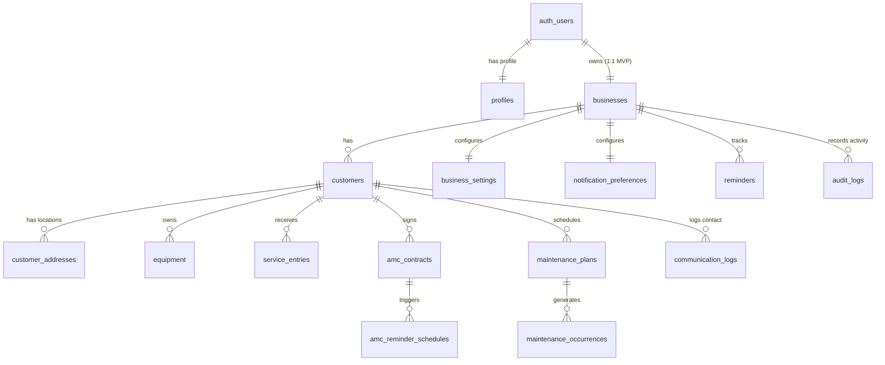

# Yaadibook — PostgreSQL Database Schema & Architecture

## 1. Schema Overview

Yaadibook's database architecture is built on PostgreSQL via Supabase. It implements a multi-tenant model isolated strictly by `business_id` while supporting a single-owner workspace per authenticated user for the MVP.

All monetary values use `NUMERIC(12, 2)` (never floating-point). Timestamps are stored in UTC with timezone (`TIMESTAMPTZ`), and date-only fields use `DATE`. The default business timezone is `Asia/Kolkata`.

---

## 2. Entity Relationship Diagram (Conceptual)

---

## 3. Database Tables Specification

### A. `profiles`
Stores the business owner's personal profile information.
- `id` (UUID, PK) -> References `auth.users(id)` ON DELETE CASCADE.
- `full_name` (TEXT, NOT NULL)
- `phone` (TEXT)
- `email` (TEXT)
- `preferred_language` (TEXT, NOT NULL, DEFAULT `'en'`, CHECK IN `('en', 'gu', 'hi')`)
- `avatar_path` (TEXT)
- `created_at` (TIMESTAMPTZ, NOT NULL)
- `updated_at` (TIMESTAMPTZ, NOT NULL)

### B. `businesses`
Stores the business workspace. One owner can own only one business in MVP.
- `id` (UUID, PK, DEFAULT `gen_random_uuid()`)
- `owner_user_id` (UUID, NOT NULL, UNIQUE) -> References `auth.users(id)` ON DELETE RESTRICT.
- `business_name` (TEXT, NOT NULL)
- `business_category` (TEXT, NOT NULL)
- `business_description` (TEXT)
- `phone` (TEXT, NOT NULL)
- `email` (TEXT)
- `address_line_1` (TEXT, NOT NULL)
- `address_line_2` (TEXT)
- `city` (TEXT, NOT NULL)
- `state` (TEXT, NOT NULL, DEFAULT `'Gujarat'`)
- `postal_code` (TEXT, NOT NULL)
- `country` (TEXT, NOT NULL, DEFAULT `'India'`)
- `logo_path` (TEXT)
- `currency_code` (TEXT, NOT NULL, DEFAULT `'INR'`)
- `timezone` (TEXT, NOT NULL, DEFAULT `'Asia/Kolkata'`)
- `preferred_language` (TEXT, NOT NULL, DEFAULT `'en'`, CHECK IN `('en', 'gu', 'hi')`)
- `is_active` (BOOLEAN, NOT NULL, DEFAULT `true`)
- `created_at` (TIMESTAMPTZ, NOT NULL)
- `updated_at` (TIMESTAMPTZ, NOT NULL)
- **Constraint**: `UNIQUE (id, owner_user_id)`

### C. `customers`
Stores customer records isolated by business.
- `id` (UUID, PK, DEFAULT `gen_random_uuid()`)
- `business_id` (UUID, NOT NULL) -> References `businesses(id)` ON DELETE CASCADE.
- `full_name` (TEXT, NOT NULL)
- `primary_phone` (TEXT, NOT NULL)
- `alternate_phone` (TEXT)
- `email` (TEXT)
- `notes` (TEXT)
- `source` (TEXT)
- `archived_at` (TIMESTAMPTZ)
- `created_at` (TIMESTAMPTZ, NOT NULL)
- `updated_at` (TIMESTAMPTZ, NOT NULL)
- **Constraint**: `UNIQUE (business_id, id)`
- **Indexes**: `(business_id)`, `(business_id, primary_phone)`, `(business_id, full_name)`, `(business_id, archived_at)`

### D. `customer_addresses`
Allows multiple locations per customer (e.g. showroom, warehouse, home).
- `id` (UUID, PK)
- `business_id` (UUID, NOT NULL)
- `customer_id` (UUID, NOT NULL)
- `address_label` (TEXT, NOT NULL, DEFAULT `'Main'`)
- `address_line_1` (TEXT, NOT NULL)
- `address_line_2` (TEXT)
- `area` (TEXT, NOT NULL)
- `city` (TEXT, NOT NULL)
- `state` (TEXT, NOT NULL, DEFAULT `'Gujarat'`)
- `postal_code` (TEXT, NOT NULL)
- `landmark` (TEXT)
- `is_default` (BOOLEAN, NOT NULL, DEFAULT `false`)
- `created_at` / `updated_at` (TIMESTAMPTZ)
- **Composite FK**: `FOREIGN KEY (business_id, customer_id) REFERENCES customers(business_id, id) ON DELETE CASCADE`

### E. `equipment` (Optional)
Tracks hardware assets (AC units, CCTV cameras, RO purifiers).
- `id` (UUID, PK)
- `business_id` (UUID, NOT NULL)
- `customer_id` (UUID, NOT NULL)
- `customer_address_id` (UUID) -> References `customer_addresses(id)` ON DELETE SET NULL.
- `equipment_name` (TEXT, NOT NULL)
- `category` (TEXT, NOT NULL)
- `brand` (TEXT)
- `model_number` (TEXT)
- `serial_number` (TEXT)
- `installation_date` (DATE)
- `warranty_start_date` (DATE)
- `warranty_end_date` (DATE)
- `notes` (TEXT)
- `status` (TEXT, NOT NULL, DEFAULT `'active'`, CHECK IN `('active', 'inactive', 'archived')`)
- `created_at` / `updated_at` (TIMESTAMPTZ)
- **Check**: `warranty_end_date IS NULL OR warranty_start_date IS NULL OR warranty_end_date >= warranty_start_date`

### F. `service_entries`
Records maintenance visits, installations, and repairs.
- `id` (UUID, PK)
- `business_id` (UUID, NOT NULL)
- `customer_id` (UUID, NOT NULL)
- `customer_address_id` (UUID) -> References `customer_addresses(id)`
- `equipment_id` (UUID, OPTIONAL) -> References `equipment(id)`
- `service_type` (TEXT, NOT NULL, CHECK IN `('installation', 'repair', 'maintenance', 'inspection', 'general', 'other')`)
- `title` (TEXT, NOT NULL)
- `description` (TEXT)
- `service_date` (DATE, NOT NULL, DEFAULT `CURRENT_DATE`)
- `status` (TEXT, NOT NULL, DEFAULT `'pending'`, CHECK IN `('pending', 'in_progress', 'completed', 'cancelled')`)
- `service_amount` (NUMERIC(12, 2), CHECK `>= 0`)
- `payment_status` (TEXT, CHECK IN `('unpaid', 'partially_paid', 'paid', 'waived')`)
- `notes` (TEXT)
- `completed_at` (TIMESTAMPTZ)
- `created_at` / `updated_at` (TIMESTAMPTZ)

### G. `maintenance_plans`
Defines recurring preventative maintenance agreements.
- `id` (UUID, PK)
- `business_id` (UUID, NOT NULL)
- `customer_id` (UUID, NOT NULL)
- `equipment_id` (UUID, OPTIONAL)
- `service_entry_id` (UUID, OPTIONAL)
- `title` (TEXT, NOT NULL)
- `frequency_type` (TEXT, NOT NULL, CHECK IN `('one_time', 'monthly', 'quarterly', 'half_yearly', 'yearly', 'custom')`)
- `interval_value` (INTEGER, CHECK `> 0`)
- `start_date` (DATE, NOT NULL)
- `next_due_date` (DATE, NOT NULL)
- `reminder_days_before` (INTEGER, NOT NULL, DEFAULT 7, CHECK `>= 0`)
- `status` (TEXT, NOT NULL, DEFAULT `'active'`, CHECK IN `('active', 'paused', 'cancelled', 'completed')`)
- `created_at` / `updated_at` (TIMESTAMPTZ)

### H. `maintenance_occurrences`
Individual scheduled service events generated from plans.
- `id` (UUID, PK)
- `business_id` (UUID, NOT NULL)
- `maintenance_plan_id` (UUID, NOT NULL) -> References `maintenance_plans(id)`
- `customer_id` (UUID, NOT NULL)
- `due_date` (DATE, NOT NULL)
- `reminder_trigger_date` (DATE, NOT NULL)
- `status` (TEXT, NOT NULL, DEFAULT `'scheduled'`, CHECK IN `('scheduled', 'due', 'overdue', 'completed', 'cancelled')`)
- `completed_service_entry_id` (UUID) -> References `service_entries(id)`
- `completed_at` (TIMESTAMPTZ)
- **Constraint**: `UNIQUE (maintenance_plan_id, due_date)` (prevents duplicate occurrences)

### I. `amc_contracts`
Annual Maintenance Contracts between the business and customer.
- `id` (UUID, PK)
- `business_id` (UUID, NOT NULL)
- `customer_id` (UUID, NOT NULL)
- `contract_title` (TEXT, NOT NULL)
- `contract_number` (TEXT)
- `start_date` (DATE, NOT NULL)
- `end_date` (DATE, NOT NULL, CHECK `end_date >= start_date`)
- `contract_amount` (NUMERIC(12, 2), NOT NULL, DEFAULT 0, CHECK `>= 0`)
- `payment_status` (TEXT, CHECK IN `('unpaid', 'partially_paid', 'paid')`)
- `status` (TEXT, NOT NULL, DEFAULT `'draft'`, CHECK IN `('draft', 'active', 'expiring', 'expired', 'renewed', 'cancelled')`)
- `document_path` (TEXT)
- `renewed_from_contract_id` (UUID) -> References `amc_contracts(id)`

### J. `amc_reminder_schedules`
Configured reminder triggers before AMC expiration (e.g. 30, 15, 7 days).
- `id` (UUID, PK)
- `business_id` (UUID, NOT NULL)
- `amc_contract_id` (UUID, NOT NULL) -> References `amc_contracts(id)`
- `days_before_expiry` (INTEGER, NOT NULL, CHECK `>= 0`)
- `is_enabled` (BOOLEAN, NOT NULL, DEFAULT `true`)
- **Constraint**: `UNIQUE (amc_contract_id, days_before_expiry)`

### K. `reminders`
Unified reminder and follow-up table for customers and general business tasks.
- `id` (UUID, PK)
- `business_id` (UUID, NOT NULL)
- `customer_id` (UUID, OPTIONAL)
- `maintenance_occurrence_id` (UUID, OPTIONAL)
- `amc_contract_id` (UUID, OPTIONAL)
- `title` (TEXT, NOT NULL)
- `reminder_type` (TEXT, NOT NULL, CHECK IN `('maintenance', 'amc', 'follow_up', 'general')`)
- `due_at` (TIMESTAMPTZ, NOT NULL)
- `timezone` (TEXT, NOT NULL, DEFAULT `'Asia/Kolkata'`)
- `status` (TEXT, NOT NULL, DEFAULT `'scheduled'`, CHECK IN `('scheduled', 'due', 'overdue', 'completed', 'cancelled')`)

### L. `communication_logs`
Activity log for customer calls, SMS, and WhatsApp messages.
- `id` (UUID, PK)
- `business_id` (UUID, NOT NULL)
- `customer_id` (UUID, NOT NULL)
- `channel` (TEXT, NOT NULL, CHECK IN `('whatsapp', 'sms', 'call', 'other')`)
- `direction` (TEXT, NOT NULL, DEFAULT `'outgoing'`, CHECK IN `('outgoing', 'incoming')`)
- `status` (TEXT, NOT NULL, DEFAULT `'initiated'`, CHECK IN `('initiated', 'opened', 'sent', 'delivered', 'failed', 'unknown')`)
- **Crucial Rule**: Opening WhatsApp or the phone dialer is logged as `initiated` or `opened`, never as `sent` or `delivered` without provider confirmation.

### M. `notification_preferences`
Owner notification toggle preferences per business.
- `id` (UUID, PK)
- `business_id` (UUID, NOT NULL, UNIQUE) -> References `businesses(id)`
- `reminder_notifications_enabled` (BOOLEAN, DEFAULT `true`)
- `maintenance_notifications_enabled` (BOOLEAN, DEFAULT `true`)
- `amc_notifications_enabled` (BOOLEAN, DEFAULT `true`)
- `followup_notifications_enabled` (BOOLEAN, DEFAULT `true`)
- `preferred_notification_time` (TIME, DEFAULT `'09:00:00'`)

### N. `business_settings`
Configurable formatting and localization preferences.
- `id` (UUID, PK)
- `business_id` (UUID, NOT NULL, UNIQUE) -> References `businesses(id)`
- `date_format` (TEXT, DEFAULT `'dd/MM/yyyy'`)
- `time_format` (TEXT, DEFAULT `'12h'`, CHECK IN `('12h', '24h')`)
- `preferred_language` (TEXT, DEFAULT `'en'`)
- `currency_code` (TEXT, DEFAULT `'INR'`)
- `timezone` (TEXT, DEFAULT `'Asia/Kolkata'`)

### O. `audit_logs`
Lightweight business activity audit log.
- `id` (UUID, PK)
- `business_id` (UUID, NOT NULL)
- `actor_user_id` (UUID, NOT NULL) -> References `auth.users(id)`
- `action` (TEXT, NOT NULL)
- `entity_type` (TEXT, NOT NULL)
- `entity_id` (UUID, NOT NULL)
- `metadata` (JSONB, NOT NULL, DEFAULT `'{}'::jsonb`)
- `created_at` (TIMESTAMPTZ, NOT NULL)

---

## 4. Source of Truth Decisions

| Configuration / Attribute | Source of Truth Table | Notes |
| :--- | :--- | :--- |
| Business Legal Name, Phone, Address | `businesses` | Primary identity of the workspace |
| UI Display Date & Time Format | `business_settings` | Formats used throughout reports and widgets |
| Default App Language | `businesses.preferred_language` & `business_settings.preferred_language` | Synced during onboarding |
| Customer Contact Details | `customers.primary_phone` | Clean E.164-compatible phone number |
| Actual Completed Service Record | `service_entries` | Immutable historical record of work performed |
| Next Due Date for Recurring Maintenance | `maintenance_plans.next_due_date` | Advances when an occurrence is completed |

