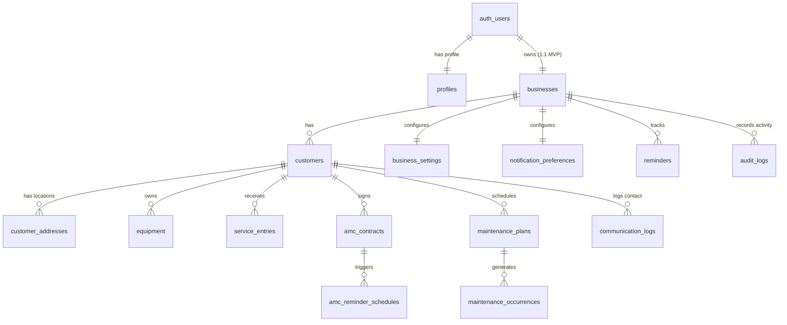

# Yaadibook — PostgreSQL Database Schema & Architecture

## 1. Schema Overview

Yaadibook's database architecture is built on PostgreSQL via Supabase. It implements a multi-tenant model isolated strictly by `business_id` while supporting a single-owner workspace per authenticated user for the MVP.

All monetary values use `NUMERIC(12, 2)` (never floating-point). Timestamps are stored in UTC with timezone (`TIMESTAMPTZ`), and date-only fields use `DATE`. The default business timezone is `Asia/Kolkata`.

---

## 2. Entity Relationship Diagram (Conceptual)

---

## 3. Database Tables Specification

### A. `profiles`
Stores the business owner's personal profile information.
- `id` (UUID, PK) -> References `auth.users(id)` ON DELETE CASCADE.
- `full_name` (TEXT, NOT NULL)
- `phone` (TEXT)
- `email` (TEXT)
- `preferred_language` (TEXT, NOT NULL, DEFAULT `'en'`, CHECK IN `('en', 'gu', 'hi')`)
- `avatar_path` (TEXT)
- `created_at` (TIMESTAMPTZ, NOT NULL)
- `updated_at` (TIMESTAMPTZ, NOT NULL)

### B. `businesses`
Stores the business workspace. One owner can own only one business in MVP.
- `id` (UUID, PK, DEFAULT `gen_random_uuid()`)
- `owner_user_id` (UUID, NOT NULL, UNIQUE) -> References `auth.users(id)` ON DELETE RESTRICT.
- `business_name` (TEXT, NOT NULL)
- `business_category` (TEXT, NOT NULL)
- `business_description` (TEXT)
- `phone` (TEXT, NOT NULL)
- `email` (TEXT)
- `address_line_1` (TEXT, NOT NULL)
- `address_line_2` (TEXT)
- `city` (TEXT, NOT NULL)
- `state` (TEXT, NOT NULL, DEFAULT `'Gujarat'`)
- `postal_code` (TEXT, NOT NULL)
- `country` (TEXT, NOT NULL, DEFAULT `'India'`)
- `logo_path` (TEXT)
- `currency_code` (TEXT, NOT NULL, DEFAULT `'INR'`)
- `timezone` (TEXT, NOT NULL, DEFAULT `'Asia/Kolkata'`)
- `preferred_language` (TEXT, NOT NULL, DEFAULT `'en'`, CHECK IN `('en', 'gu', 'hi')`)
- `is_active` (BOOLEAN, NOT NULL, DEFAULT `true`)
- `created_at` (TIMESTAMPTZ, NOT NULL)
- `updated_at` (TIMESTAMPTZ, NOT NULL)
- **Constraint**: `UNIQUE (id, owner_user_id)`

### C. `customers`
Stores customer records isolated by business.
- `id` (UUID, PK, DEFAULT `gen_random_uuid()`)
- `business_id` (UUID, NOT NULL) -> References `businesses(id)` ON DELETE CASCADE.
- `full_name` (TEXT, NOT NULL)
- `primary_phone` (TEXT, NOT NULL)
- `alternate_phone` (TEXT)
- `email` (TEXT)
- `customer_type` (TEXT, NOT NULL, DEFAULT `'individual'`, CHECK IN `('individual', 'business')`) — Added in migration `20261105160001_add_customer_type.sql`
- `notes` (TEXT)
- `source` (TEXT)
- `archived_at` (TIMESTAMPTZ)
- `created_at` (TIMESTAMPTZ, NOT NULL)
- `updated_at` (TIMESTAMPTZ, NOT NULL)
- **Constraint**: `UNIQUE (business_id, id)`
- **Indexes**: `(business_id)`, `(business_id, primary_phone)`, `(business_id, full_name)`, `(business_id, customer_type)`, `(business_id, archived_at)`

### D. `customer_addresses`
Allows multiple locations per customer (e.g. showroom, warehouse, home).
- `id` (UUID, PK)
- `business_id` (UUID, NOT NULL)
- `customer_id` (UUID, NOT NULL)
- `address_label` (TEXT, NOT NULL, DEFAULT `'Main'`)
- `address_line_1` (TEXT, NOT NULL)
- `address_line_2` (TEXT)
- `area` (TEXT, NOT NULL)
- `city` (TEXT, NOT NULL)
- `state` (TEXT, NOT NULL, DEFAULT `'Gujarat'`)
- `postal_code` (TEXT, NOT NULL)
- `landmark` (TEXT)
- `is_default` (BOOLEAN, NOT NULL, DEFAULT `false`)
- `created_at` / `updated_at` (TIMESTAMPTZ)
- **Composite FK**: `FOREIGN KEY (business_id, customer_id) REFERENCES customers(business_id, id) ON DELETE CASCADE`

### E. `equipment` (Optional)
Tracks hardware assets (AC units, CCTV cameras, RO purifiers).
- `id` (UUID, PK)
- `business_id` (UUID, NOT NULL)
- `customer_id` (UUID, NOT NULL)
- `customer_address_id` (UUID) -> References `customer_addresses(id)` ON DELETE SET NULL.
- `equipment_name` (TEXT, NOT NULL)
- `category` (TEXT, NOT NULL)
- `brand` (TEXT)
- `model_number` (TEXT)
- `serial_number` (TEXT)
- `installation_date` (DATE)
- `warranty_start_date` (DATE)
- `warranty_end_date` (DATE)
- `notes` (TEXT)
- `status` (TEXT, NOT NULL, DEFAULT `'active'`, CHECK IN `('active', 'inactive', 'archived')`)
- `created_at` / `updated_at` (TIMESTAMPTZ)
- **Check**: `warranty_end_date IS NULL OR warranty_start_date IS NULL OR warranty_end_date >= warranty_start_date`

### F. `service_entries`
Records maintenance visits, installations, and repairs.
- `id` (UUID, PK)
- `business_id` (UUID, NOT NULL)
- `customer_id` (UUID, NOT NULL)
- `customer_address_id` (UUID) -> References `customer_addresses(id)`
- `equipment_id` (UUID, OPTIONAL) -> References `equipment(id)`
- `service_number` (VARCHAR(30), NOT NULL, format `YB-SRV-XXXXXX`)
- `service_type` (TEXT, NOT NULL, CHECK IN `('installation', 'repair', 'maintenance', 'inspection', 'general', 'other')`)
- `title` (TEXT, NOT NULL)
- `description` (TEXT)
- `work_performed` (TEXT)
- `service_date` (DATE, NOT NULL, DEFAULT `CURRENT_DATE`)
- `status` (TEXT, NOT NULL, DEFAULT `'pending'`, CHECK IN `('pending', 'in_progress', 'completed', 'cancelled')`)
- `service_amount` (NUMERIC(12, 2), CHECK `>= 0`)
- `additional_charges` (NUMERIC(12, 2), NOT NULL, DEFAULT `0.00`, CHECK `>= 0`)
- `discount_amount` (NUMERIC(12, 2), NOT NULL, DEFAULT `0.00`, CHECK `>= 0`)
- `total_amount` (NUMERIC(12, 2), NOT NULL, DEFAULT `0.00`, CHECK `>= 0`)
- `payment_status` (TEXT, CHECK IN `('unpaid', 'partially_paid', 'paid', 'waived')`)
- `notes` (TEXT)
- `completed_at` (TIMESTAMPTZ)
- `created_at` / `updated_at` (TIMESTAMPTZ)

### G. `business_sequences`
Per-business monotonic atomic sequences for human-readable reference numbers (`SRV-YYYYMM-XXXX`, `MP-YYYYMM-XXXX`, `AMC-YYYYMM-XXXX`).
- `business_id` (UUID, PK) -> References `businesses(id)`
- `service_seq` (BIGINT, NOT NULL, DEFAULT `0`)
- `maintenance_seq` (BIGINT, NOT NULL, DEFAULT `0`)
- `amc_seq` (BIGINT, NOT NULL, DEFAULT `0`)
- `updated_at` (TIMESTAMPTZ)

### H. `service_attachments`
Uploaded photos, diagnosis receipts, and PDF documents.
- `id` (UUID, PK)
- `business_id` (UUID, NOT NULL) -> References `businesses(id)`
- `service_id` (UUID, NOT NULL) -> References `service_entries(id)` ON DELETE CASCADE
- `file_path` (TEXT, NOT NULL) -> Path inside private `service-attachments` bucket
- `file_name` (TEXT, NOT NULL)
- `file_size` (BIGINT)
- `mime_type` (TEXT)
- `created_at` (TIMESTAMPTZ)

### I. `service_activities`
Immutable chronological audit history for service entry lifecycle and changes.
- `id` (UUID, PK)
- `business_id` (UUID, NOT NULL) -> References `businesses(id)`
- `service_id` (UUID, NOT NULL) -> References `service_entries(id)` ON DELETE CASCADE
- `activity_type` (TEXT, NOT NULL)
- `title` (TEXT, NOT NULL)
- `description` (TEXT)
- `old_status` (TEXT)
- `new_status` (TEXT)
- `actor_user_id` (UUID) -> References `auth.users(id)`
- `metadata` (JSONB, NOT NULL, DEFAULT `'{}'`)
- `created_at` (TIMESTAMPTZ)

### J. `maintenance_plans`
Defines recurring preventative maintenance agreements. Enhanced in Phase 7 (`20261106170001_maintenance_and_amc_enhancements.sql`).
- `id` (UUID, PK)
- `business_id` (UUID, NOT NULL) -> References `businesses(id)`
- `customer_id` (UUID, NOT NULL) -> References `customers(id)`
- `equipment_id` (UUID, OPTIONAL) -> References `equipment(id)`
- `service_entry_id` (UUID, OPTIONAL) -> References `service_entries(id)`
- `plan_number` (TEXT) -> Sequential formatted number (e.g. `MP-202611-0001`)
- `title` (TEXT, NOT NULL)
- `frequency_type` (TEXT, NOT NULL, CHECK IN `('one_time', 'monthly', 'quarterly', 'half_yearly', 'yearly', 'custom')`)
- `interval_value` (INTEGER, CHECK `> 0`)
- `custom_interval_unit` (TEXT, CHECK IN `('days', 'weeks', 'months', 'years')`)
- `anchor_day` (INTEGER, CHECK `anchor_day BETWEEN 1 AND 31`) -> Preserves original month-end day
- `start_date` (DATE, NOT NULL)
- `end_date` (DATE) -> Optional end date for finite recurring plans
- `next_due_date` (DATE, NOT NULL)
- `reminder_days_before` (INTEGER, NOT NULL, DEFAULT 3, CHECK `>= 0`)
- `instructions` (TEXT) -> Checklist or operational instructions
- `status` (TEXT, NOT NULL, DEFAULT `'active'`, CHECK IN `('active', 'paused', 'cancelled', 'completed')`)
- `created_at` / `updated_at` (TIMESTAMPTZ)

### K. `maintenance_occurrences`
Individual scheduled service events generated from plans. Enhanced in Phase 7 (`20261106170001_maintenance_and_amc_enhancements.sql`).
- `id` (UUID, PK)
- `business_id` (UUID, NOT NULL) -> References `businesses(id)`
- `maintenance_plan_id` (UUID, NOT NULL) -> References `maintenance_plans(id)` ON DELETE CASCADE
- `customer_id` (UUID, NOT NULL) -> References `customers(id)`
- `due_date` (DATE, NOT NULL)
- `original_due_date` (DATE) -> Preserves initial schedule when rescheduled
- `rescheduled_reason` (TEXT)
- `rescheduled_at` (TIMESTAMPTZ)
- `skip_reason` (TEXT)
- `skipped_at` (TIMESTAMPTZ)
- `work_report` (TEXT)
- `completion_notes` (TEXT)
- `amount_charged` (NUMERIC(10, 2), DEFAULT 0)
- `reminder_trigger_date` (DATE, NOT NULL)
- `status` (TEXT, NOT NULL, DEFAULT `'scheduled'`, CHECK IN `('scheduled', 'due', 'overdue', 'completed', 'skipped', 'cancelled')`)
- `completed_service_entry_id` (UUID) -> References `service_entries(id)`
- `completed_at` (TIMESTAMPTZ)
- **Constraint**: `UNIQUE (maintenance_plan_id, due_date)` (prevents duplicate occurrences)

### L. `amc_contracts`
Annual Maintenance Contracts between the business and customer. Enhanced in Phase 7 (`20261106170001_maintenance_and_amc_enhancements.sql`).
- `id` (UUID, PK)
- `business_id` (UUID, NOT NULL) -> References `businesses(id)`
- `customer_id` (UUID, NOT NULL) -> References `customers(id)`
- `equipment_id` (UUID, OPTIONAL) -> References `equipment(id)`
- `contract_number` (TEXT) -> Sequential formatted number (e.g. `AMC-202611-0001`)
- `plan_name` (TEXT, NOT NULL)
- `start_date` (DATE, NOT NULL)
- `end_date` (DATE, NOT NULL, CHECK `end_date >= start_date`)
- `amount` (NUMERIC(10, 2), NOT NULL, DEFAULT 0, CHECK `>= 0`)
- `payment_status` (TEXT, NOT NULL, DEFAULT `'pending'`, CHECK IN `('pending', 'partial', 'paid')`)
- `terms_conditions` (TEXT)
- `notes` (TEXT)
- `status` (TEXT, NOT NULL, DEFAULT `'active'`, CHECK IN `('active', 'expiring', 'expired', 'renewed', 'cancelled')`)
- `renewed_from_contract_id` (UUID) -> References `amc_contracts(id)`
- `renewed_to_contract_id` (UUID) -> References `amc_contracts(id)`
- `created_at` / `updated_at` (TIMESTAMPTZ)

### M. `amc_reminder_schedules`
Configured reminder triggers before AMC expiration (e.g. 30, 15, 7 days).
- `id` (UUID, PK)
- `business_id` (UUID, NOT NULL) -> References `businesses(id)`
- `amc_contract_id` (UUID, NOT NULL) -> References `amc_contracts(id)`
- `days_before_expiry` (INTEGER, NOT NULL, CHECK `>= 0`)
- `is_enabled` (BOOLEAN, NOT NULL, DEFAULT `true`)
- **Constraint**: `UNIQUE (amc_contract_id, days_before_expiry)`

### N. `reminders`
Unified reminder and follow-up table for customers, maintenance, AMC, and general business tasks. Enhanced in Phase 8 (`20261106180001_unified_reminders_and_notifications.sql`).
- `id` (UUID, PK)
- `business_id` (UUID, NOT NULL) -> References `businesses(id)` ON DELETE CASCADE
- `customer_id` (UUID, OPTIONAL) -> References `customers(id)` ON DELETE SET NULL
- `service_id` (UUID, OPTIONAL) -> References `services(id)` ON DELETE SET NULL
- `source_type` (VARCHAR(50), NOT NULL, DEFAULT `'manual'`) — `'manual'`, `'maintenance_occurrence'`, `'amc_contract'`, `'service_followup'`
- `source_id` (UUID, OPTIONAL)
- `title` (VARCHAR(255), NOT NULL)
- `description` (TEXT)
- `due_at` (TIMESTAMPTZ, NOT NULL)
- `original_due_at` (TIMESTAMPTZ)
- `snoozed_until` (TIMESTAMPTZ)
- `status` (VARCHAR(50), NOT NULL, DEFAULT `'pending'`, CHECK IN `('pending', 'snoozed', 'completed', 'cancelled')`)
- `priority` (VARCHAR(20), NOT NULL, DEFAULT `'normal'`, CHECK IN `('low', 'normal', 'high', 'urgent')`)
- `category` (VARCHAR(50), NOT NULL, DEFAULT `'general'`, CHECK IN `('maintenance', 'amc', 'followup', 'payment', 'call', 'visit', 'general')`)
- `action_type` (VARCHAR(50), DEFAULT `'general_task'`)
- `action_payload` (JSONB, DEFAULT `'{}'::jsonb`)
- `is_auto_generated` (BOOLEAN, DEFAULT `false`)
- `completed_at` (TIMESTAMPTZ)
- `completed_by_user_id` (UUID) -> References `auth.users(id)`
- `completed_notes` (TEXT)
- `created_at` (TIMESTAMPTZ, NOT NULL)
- `updated_at` (TIMESTAMPTZ, NOT NULL)
- **Indexes**: `(business_id, status)`, `(business_id, due_at)`, `(business_id, category)`, `(business_id, source_type, source_id)`

### O. `communication_logs`
Activity log for customer calls, SMS, and WhatsApp messages.
- `id` (UUID, PK)
- `business_id` (UUID, NOT NULL)
- `customer_id` (UUID, NOT NULL)
- `channel` (TEXT, NOT NULL, CHECK IN `('whatsapp', 'sms', 'call', 'other')`)
- `direction` (TEXT, NOT NULL, DEFAULT `'outgoing'`, CHECK IN `('outgoing', 'incoming')`)
- `status` (TEXT, NOT NULL, DEFAULT `'initiated'`, CHECK IN `('initiated', 'opened', 'sent', 'delivered', 'failed', 'unknown')`)
- **Crucial Rule**: Opening WhatsApp or the phone dialer is logged as `initiated` or `opened`, never as `sent` or `delivered` without provider confirmation.

### P. `notification_preferences`
Owner notification toggle preferences and quiet hours per business. Enhanced in Phase 8.
- `id` (UUID, PK)
- `business_id` (UUID, NOT NULL, UNIQUE) -> References `businesses(id)` ON DELETE CASCADE
- `push_notifications_enabled` (BOOLEAN, NOT NULL, DEFAULT `true`)
- `maintenance_notifications_enabled` (BOOLEAN, NOT NULL, DEFAULT `true`)
- `amc_notifications_enabled` (BOOLEAN, NOT NULL, DEFAULT `true`)
- `followup_notifications_enabled` (BOOLEAN, NOT NULL, DEFAULT `true`)
- `general_notifications_enabled` (BOOLEAN, NOT NULL, DEFAULT `true`)
- `maintenance_advance_days` (INT[], NOT NULL, DEFAULT `ARRAY[7, 3, 1, 0]`)
- `amc_advance_days` (INT[], NOT NULL, DEFAULT `ARRAY[30, 15, 7, 1, 0]`)
- `quiet_hours_enabled` (BOOLEAN, NOT NULL, DEFAULT `true`)
- `quiet_hours_start` (TIME, NOT NULL, DEFAULT `'22:00:00'`)
- `quiet_hours_end` (TIME, NOT NULL, DEFAULT `'08:00:00'`)
- `preferred_notification_time` (TIME, NOT NULL, DEFAULT `'09:00:00'`)
- `created_at` (TIMESTAMPTZ, NOT NULL)
- `updated_at` (TIMESTAMPTZ, NOT NULL)

### Q. `device_tokens`
Stores FCM device tokens for mobile push notifications. Added in Phase 8.
- `id` (UUID, PK, DEFAULT `gen_random_uuid()`)
- `business_id` (UUID, NOT NULL) -> References `businesses(id)` ON DELETE CASCADE
- `user_id` (UUID, NOT NULL) -> References `auth.users(id)` ON DELETE CASCADE
- `fcm_token` (TEXT, NOT NULL)
- `platform` (VARCHAR(20), NOT NULL, DEFAULT `'android'`, CHECK IN `('android', 'ios', 'web')`)
- `device_name` (VARCHAR(100))
- `device_id` (VARCHAR(100))
- `is_active` (BOOLEAN, NOT NULL, DEFAULT `true`)
- `last_used_at` (TIMESTAMPTZ)
- `created_at` (TIMESTAMPTZ, NOT NULL)
- `updated_at` (TIMESTAMPTZ, NOT NULL)
- **Constraint**: `UNIQUE (business_id, fcm_token)`
- **Indexes**: `(business_id, is_active)`, `(user_id)`

### R. `in_app_notifications`
Persistent notifications surfaced in the in-app Notification Centre (`/notifications`). Added in Phase 8.
- `id` (UUID, PK, DEFAULT `gen_random_uuid()`)
- `business_id` (UUID, NOT NULL) -> References `businesses(id)` ON DELETE CASCADE
- `user_id` (UUID) -> References `auth.users(id)` ON DELETE CASCADE
- `reminder_id` (UUID) -> References `reminders(id)` ON DELETE SET NULL
- `title` (VARCHAR(255), NOT NULL)
- `body` (TEXT, NOT NULL)
- `category` (VARCHAR(50), NOT NULL, DEFAULT `'general'`, CHECK IN `('maintenance', 'amc', 'followup', 'general', 'system')`)
- `payload` (JSONB, DEFAULT `'{}'::jsonb`)
- `is_read` (BOOLEAN, NOT NULL, DEFAULT `false`)
- `read_at` (TIMESTAMPTZ)
- `created_at` (TIMESTAMPTZ, NOT NULL)
- **Indexes**: `(business_id, is_read)`, `(business_id, created_at DESC)`

### S. `notification_queue`
Server-side background notification dispatch queue. Added in Phase 8.
- `id` (UUID, PK, DEFAULT `gen_random_uuid()`)
- `business_id` (UUID, NOT NULL) -> References `businesses(id)` ON DELETE CASCADE
- `reminder_id` (UUID) -> References `reminders(id)` ON DELETE CASCADE
- `device_token_id` (UUID) -> References `device_tokens(id)` ON DELETE SET NULL
- `notification_type` (VARCHAR(50), NOT NULL, CHECK IN `('push', 'in_app')`)
- `status` (VARCHAR(50), NOT NULL, DEFAULT `'queued'`, CHECK IN `('queued', 'sent_to_provider', 'provider_accepted', 'delivered', 'failed', 'cancelled')`)
- `scheduled_for` (TIMESTAMPTZ, NOT NULL)
- `retry_count` (INT, NOT NULL, DEFAULT `0`)
- `max_retries` (INT, NOT NULL, DEFAULT `3`)
- `last_error` (TEXT)
- `payload` (JSONB, NOT NULL, DEFAULT `'{}'::jsonb`)
- `deduplication_key` (VARCHAR(150), UNIQUE)
- `sent_at` (TIMESTAMPTZ)
- `created_at` (TIMESTAMPTZ, NOT NULL)
- `updated_at` (TIMESTAMPTZ, NOT NULL)
- **Indexes**: `(status, scheduled_for)`, `(business_id)`

### T. `business_settings`
Configurable formatting and localization preferences.
- `id` (UUID, PK)
- `business_id` (UUID, NOT NULL, UNIQUE) -> References `businesses(id)`
- `date_format` (TEXT, DEFAULT `'dd/MM/yyyy'`)
- `time_format` (TEXT, DEFAULT `'12h'`, CHECK IN `('12h', '24h')`)
- `preferred_language` (TEXT, DEFAULT `'en'`)
- `currency_code` (TEXT, DEFAULT `'INR'`)
- `timezone` (TEXT, DEFAULT `'Asia/Kolkata'`)

### U. `audit_logs`
Lightweight business activity audit log.
- `id` (UUID, PK)
- `business_id` (UUID, NOT NULL)
- `actor_user_id` (UUID, NOT NULL) -> References `auth.users(id)`
- `action` (TEXT, NOT NULL)
- `entity_type` (TEXT, NOT NULL)
- `entity_id` (UUID, NOT NULL)
- `metadata` (JSONB, NOT NULL, DEFAULT `'{}'::jsonb`)
- `created_at` (TIMESTAMPTZ, NOT NULL)

---

## 4. Source of Truth Decisions

| Configuration / Attribute | Source of Truth Table | Notes |
| :--- | :--- | :--- |
| Business Legal Name, Phone, Address | `businesses` | Primary identity of the workspace |
| UI Display Date & Time Format | `business_settings` | Formats used throughout reports and widgets |
| Default App Language | `businesses.preferred_language` & `business_settings.preferred_language` | Synced during onboarding |
| Customer Contact Details | `customers.primary_phone` | Clean E.164-compatible phone number |
| Actual Completed Service Record | `service_entries` | Immutable historical record of work performed |
| Next Due Date for Recurring Maintenance | `maintenance_plans.next_due_date` | Advances when an occurrence is completed |
| Active AMC Contract Record | `amc_contracts` | Non-destructive renewal links predecessor and successor |

---

## 5. Stored Procedures & Atomic Business Functions

Phase 7 introduced dedicated PL/pgSQL stored procedures to ensure transactions and atomic operations:

1. **`calculate_next_maintenance_date(p_current_due_date, p_frequency_type, p_interval_value, p_custom_interval_unit, p_anchor_day)`**:
   Calculates recurrence dates while rigorously preserving month-end anchor days (e.g., 31 Jan -> 28 Feb -> 31 Mar).
2. **`complete_maintenance_occurrence(p_occurrence_id, p_work_report, p_completion_notes, p_amount_charged)`**:
   Marks occurrence completed, logs charges/notes, and atomically computes and creates the next occurrence for recurring plans.
3. **`skip_maintenance_occurrence(p_occurrence_id, p_skip_reason)`**:
   Marks occurrence skipped with audit reason, and generates the next occurrence.
4. **`renew_amc_contract(p_old_contract_id, p_new_start_date, p_new_end_date, p_new_amount, p_new_payment_status, p_new_terms, p_new_notes)`**:
   Generates a new sequential AMC contract referencing the old contract, and transitions the old contract to `renewed`.
5. **`next_maintenance_plan_number(p_business_id)`**:
   Monotonically generates `MP-YYYYMM-XXXX`.
6. **`next_amc_contract_number(p_business_id)`**:
   Monotonically generates `AMC-YYYYMM-XXXX`.

Phase 8 introduced stored procedures for unified reminders, quiet hours, and notification dispatch:

7. **`is_in_quiet_hours(p_business_id)`**:
   Evaluates business quiet hours preferences against current Indian Standard Time (`Asia/Kolkata`), correctly handling midnight-crossing ranges.
8. **`snooze_reminder(p_reminder_id, p_snooze_until)`**:
   Transitions reminder to `snoozed`, preserves `original_due_at`, and updates active `due_at`.
9. **`complete_reminder(p_reminder_id, p_notes)`**:
   Marks reminder `completed` with timestamp, completion notes, actor ID, and cancels pending items in `notification_queue`.
10. **`reconcile_maintenance_occurrence_reminder(p_occurrence_id)`**:
    Idempotently creates or updates reminder linked to a maintenance occurrence without duplicates.
11. **`reconcile_amc_contract_reminders(p_contract_id)`**:
    Idempotently creates or updates expiry renewal reminders for an AMC contract.
12. **`register_device_token(p_fcm_token, p_platform, p_device_name, p_device_id)`**:
    Registers or reactivates client FCM device token isolated to the authenticated business workspace.
13. **`mark_all_notifications_read(p_business_id)`**:
    Atomically marks all unread notifications read for the business workspace.

