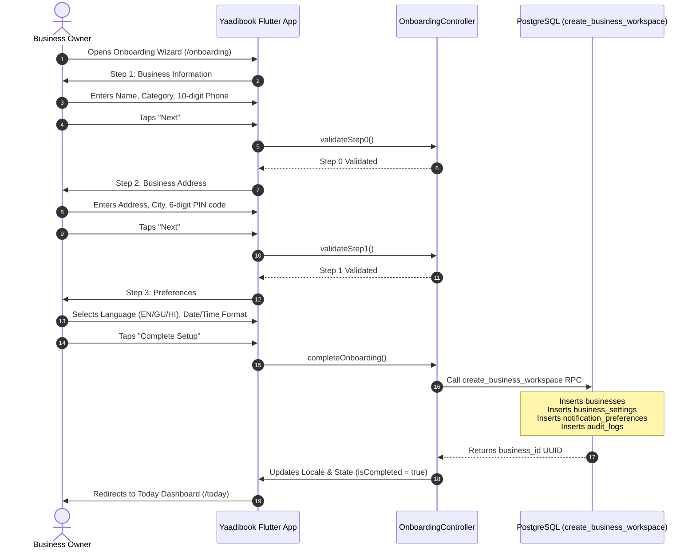

# Yaadibook — Single-Business Onboarding Flow & Architecture

## 1. Overview

The Yaadibook onboarding experience guides newly registered service business owners through a frictionless 3-step mobile wizard to provision their single business workspace.

---

## 2. Onboarding Workflow

---

## 3. Step-by-Step Breakdown

### Step 1: Business Information
- **Business Name** (Required): e.g. *Patel Security Solutions*.
- **Business Category** (Required): Dropdown selection from standard Indian service trades:
  1. CCTV & Security Systems
  2. AC & HVAC Services
  3. RO & Water Purifier
  4. Appliance Repair
  5. Electrical Services
  6. Plumbing Services
  7. General Maintenance
  8. Other (reveals custom category text input)
- **Business Phone / WhatsApp** (Required): 10-digit Indian mobile number prefixed with `+91`. Validated with regex `^\d{10}$`.
- **Business Email** (Optional): Secondary contact email.

### Step 2: Business Address
- **Address Line 1** (Required): Shop / Office number, building name.
- **Address Line 2 / Area** (Optional): Road, landmark, area.
- **City** (Required): e.g. *Ahmedabad*, *Surat*, *Rajkot*, *Vadodara*.
- **State** (Required): Defaulted to *Gujarat*, editable.
- **PIN Code** (Required): 6-digit Indian postal code. Validated with regex `^\d{6}$`.
- **Country**: Defaulted to *India* (read-only for MVP).

### Step 3: Preferences
- **App Language**: Interactive selector for English, ગુજરાતી, and हिन्दी. Switching immediately updates the entire app UI.
- **Date Format**: Defaulted to `DD/MM/YYYY`.
- **Time Format**: Defaulted to `12-hour` display (e.g. `02:30 PM`).
- **Timezone**: Defaulted to `Asia/Kolkata` (IST - UTC+5:30).

---

## 4. Atomic Workspace Creation RPC

To avoid partial records or orphaned states, workspace provisioning runs through the `create_business_workspace` PostgreSQL function within an atomic transaction:
1. Enforces `auth.uid() = owner_user_id`.
2. Checks unique constraint (1 owner = 1 business in MVP).
3. Inserts into `public.businesses`.
4. Inserts matching defaults into `public.business_settings`.
5. Inserts matching defaults into `public.notification_preferences`.
6. Writes audit record in `public.audit_logs`.
7. Updates the owner's `preferred_language` in `public.profiles`.
8. Returns the newly generated workspace `UUID`.

---

## 5. Failure Recovery & Form Preservation

If a network glitch or database error occurs during submission:
- Form fields are completely preserved in `OnboardingFormState`.
- User is shown a clear error banner.
- User can retry safely without having to re-enter their information.
