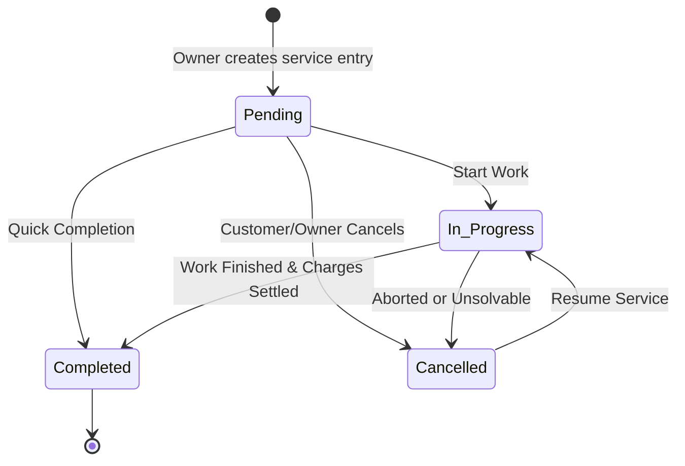
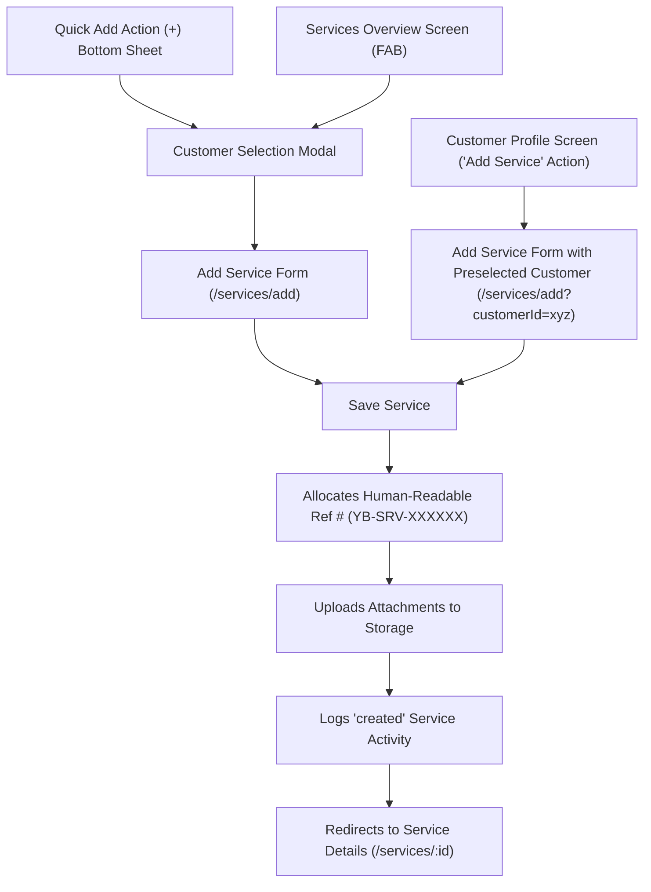
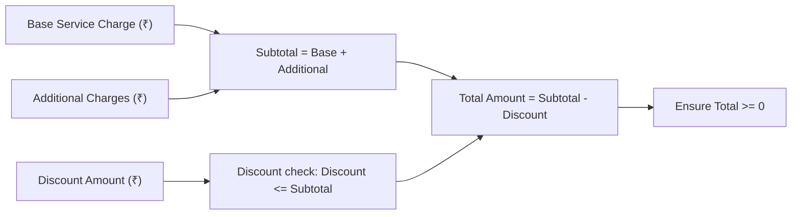

# Yaadibook — Service Workflow & Lifecycle Architecture

## 1. Lifecycle State Machine

A service record transitions through explicit lifecycle states designed for real-world field servicing.

### Transition Specifications

| Current State | Target State | Trigger / User Action | Required Data / Notes |
|---|---|---|---|
| `*` (New) | `Pending` | Add Service submitted with status `pending` | Customer, Title, Type, Date |
| `*` (New) | `In Progress` | Add Service submitted with status `in_progress` | Customer, Title, Type, Date |
| `Pending` | `In Progress` | Tap "Start Work" in Detail screen or Overview | Updates `status`, logs `status_changed` |
| `Pending` or `In Progress` | `Completed` | Tap "Mark Completed" | Prompts optional work performed notes, sets `completed_at: NOW()` |
| `Pending` or `In Progress` | `Cancelled` | Tap "Cancel Service" | Prompts cancellation reason, sets status to `cancelled` |
| `Cancelled` | `In Progress` | Tap "Resume Service" | Reopens cancelled job, resets to `in_progress` |

---

## 2. Creation Entry Points

---

## 3. Financial Calculation Flow

- Validation Rule 1: Amounts must be non-negative ($\ge 0$).
- Validation Rule 2: $\text{Discount} \le \text{Base} + \text{Additional}$.
- Validation Rule 3: $\text{Total Amount} = \max(0, \text{Base} + \text{Additional} - \text{Discount})$.

