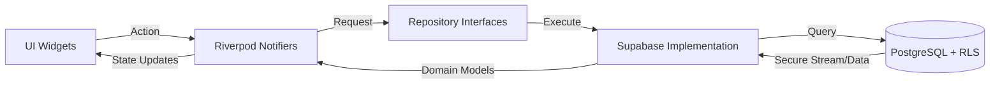

# Yaadibook — Technical Architecture

## 1. Architectural Principles

Yaadibook follows a **Feature-First Architecture** with strict layer separation and unidirectional data flow. Business logic is strictly decoupled from presentation widgets.

```
lib/
├── app/                  # Application root, routing, theme, localization, configs
│   ├── app.dart          # MaterialApp root entry
│   ├── config/           # AppConfig & environment management
│   ├── localization/     # ARB definitions & LocaleProvider
│   ├── router/           # GoRouter route declarations & shell
│   └── theme/            # Central design tokens, typography, theme data
├── core/                 # Shared foundations & cross-cutting concerns
│   ├── constants/        # Global regex, symbols, constants
│   ├── errors/           # App exceptions & error models
│   ├── extensions/       # BuildContext & formatting extensions
│   ├── services/         # Secure storage, Supabase client wrapper
│   ├── utils/            # CurrencyFormatter, DateFormatter, AppLogger
│   └── widgets/          # 16 reusable core Design System components
├── features/             # Modular feature slices
│   ├── dashboard/        # Today screen, quick metrics, quick add
│   ├── customers/        # Customer directory & details
│   ├── services/         # Service records
│   ├── equipment/        # Optional equipment tracking
│   ├── maintenance/      # Maintenance schedules
│   ├── amc/              # AMC contract tracking
│   ├── reminders/        # Follow-ups & alert views
│   ├── communication/    # WhatsApp / phone triggers
│   └── settings/         # Language selection, profile, app info
└── shared/               # Shared domain entities & cross-feature providers
    ├── models/           # Domain models (User, Business, Customer, Service, AMC, Reminder)
    ├── providers/        # Riverpod backend providers & DI
    └── repositories/     # Repository interfaces & Supabase implementations
```

---

## 2. Technology Stack & Key Dependencies

| Technology | Purpose | Selection Rationale |
| :--- | :--- | :--- |
| **Flutter 3.41+ & Dart 3.11+** | Cross-platform Framework | High performance, single codebase targeting Android & iOS |
| **flutter_riverpod: ^2.6.1** | State Management | Compile-safe, testable, dependency injection without context coupling |
| **go_router: ^14.8.1** | Navigation & Deep Linking | Declarative routing, `StatefulShellRoute` for seamless bottom tab state |
| **Material 3** | Visual Design Foundation | Modern baseline customized with Yaadibook design tokens |
| **flutter_localizations & intl** | Multilingual & Formatting | Standard Flutter localization using `.arb` files, localized dates & INR currency |
| **flutter_secure_storage: ^9.2.4** | Secure Storage | Encrypted storage for auth tokens and user preferences (EncryptedSharedPreferences / Keychain) |
| **supabase_flutter: ^2.8.4** | Backend Integration | Supabase PostgreSQL client, Auth, and Storage |
| **google_fonts: ^6.2.1** | Multilingual Typography | Consistent typography across Android OEMs supporting Gujarati, Devanagari & Latin |
| **PostgreSQL 15+ (Supabase)** | Relational Database | Strict relational constraints, Row Level Security, JSONB audit logs |

---

## 3. Data Flow Architecture

Each feature module is organized into four layers:



1. **Presentation / UI Layer**:
   - Flutter `ConsumerWidget` or `StatefulWidget`.
   - Strictly renders UI from Riverpod providers.
   - Delegates user intent to Notifiers/ViewModels.
2. **State / ViewModel Layer**:
   - `StateNotifier<T>` or `AsyncNotifier<T>`.
   - Manages UI state, loading flags, and error transformations.
3. **Repository Layer**:
   - Abstract repository contracts (`ICustomerRepository`, `IServiceRepository`, `IReminderRepository`, `IBusinessRepository`, `IAuthRepository`).
   - Handles network errors and maps JSON responses into immutable domain models.
4. **Data / Backend Layer**:
   - `SupabaseClient` for remote DB calls.
   - Protected by Row Level Security (RLS) policies.
   - `SecureStorageService` for encrypted local key-value data.

---

## 4. Configuration & Security Boundary

### Safe Client-Side Values (Public)
The following are embedded via `--dart-define` or build environment and are safe to ship in the APK/bundle:
- `APP_ENV`: Environment identifier (`dev`, `staging`, `prod`).
- `SUPABASE_URL`: Public Supabase project HTTPS URL.
- `SUPABASE_ANON_KEY`: Public anonymous API key protected by Supabase Row Level Security (RLS) policies.

### Forbidden Client-Side Values (Never in App)
The following must **NEVER** be present anywhere in the Flutter codebase, assets, or client environment:
- `SUPABASE_SERVICE_ROLE_KEY`: Completely bypasses RLS policies. Must only reside in Supabase Edge Functions or backend services.
- Database master credentials / direct connection strings (`postgres://...`).
- Payment gateway secret keys or WhatsApp Business API access tokens.

---

## 5. Multilingual & Script Support Architecture

- Translations are maintained in `lib/app/localization/arb/`:
  - `app_en.arb` (English - default)
  - `app_gu.arb` (Gujarati)
  - `app_hi.arb` (Hindi)
- Generated classes output to `lib/app/localization/generated/app_localizations.dart`.
- `AppLocaleNotifier` manages active runtime locale and persists user selection via `SecureStorageService`.
- Noto Sans typography stack ensures non-breaking rendering for compound Gujarati consonants and Devanagari ligatures.
