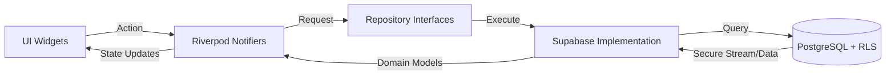

# Yaadibook — Technical Architecture

## 1. Architectural Principles

Yaadibook follows a **Feature-First Architecture** with strict layer separation and unidirectional data flow. Business logic is strictly decoupled from presentation widgets.

```
lib/
├── app/                  # Application root, routing, theme, localization, configs
│   ├── app.dart          # MaterialApp root entry
│   ├── config/           # AppConfig & environment management
│   ├── localization/     # ARB definitions & LocaleProvider
│   ├── router/           # GoRouter route declarations & shell
│   └── theme/            # Central design tokens, typography, theme data
├── core/                 # Shared foundations & cross-cutting concerns
│   ├── constants/        # Global regex, symbols, constants
│   ├── errors/           # App exceptions & error models
│   ├── extensions/       # BuildContext & formatting extensions
│   ├── services/         # Secure storage, Supabase client wrapper
│   ├── utils/            # CurrencyFormatter, DateFormatter, AppLogger
│   └── widgets/          # 16 reusable core Design System components
├── features/             # Modular feature slices
│   ├── dashboard/        # Today screen, quick metrics, quick add
│   ├── customers/        # Customer directory & details
│   ├── services/         # Service records
│   ├── equipment/        # Optional equipment tracking
│   ├── maintenance/      # Maintenance schedules
│   ├── amc/              # AMC contract tracking
│   ├── reminders/        # Follow-ups & alert views
│   ├── communication/    # WhatsApp / phone triggers
│   └── settings/         # Language selection, profile, app info
└── shared/               # Shared domain entities & cross-feature providers
    ├── models/           # Domain models (User, Business, Customer, Service, AMC, Reminder)
    ├── providers/        # Riverpod backend providers & DI
    └── repositories/     # Repository interfaces & Supabase implementations
```

---

## 2. Technology Stack & Key Dependencies

| Technology | Purpose | Selection Rationale |
| :--- | :--- | :--- |
| **Flutter 3.41+ & Dart 3.11+** | Cross-platform Framework | High performance, single codebase targeting Android & iOS |
| **flutter_riverpod: ^2.6.1** | State Management | Compile-safe, testable, dependency injection without context coupling |
| **go_router: ^14.8.1** | Navigation & Deep Linking | Declarative routing, `StatefulShellRoute` for seamless bottom tab state |
| **Material 3** | Visual Design Foundation | Modern baseline customized with Yaadibook design tokens |
| **flutter_localizations & intl** | Multilingual & Formatting | Standard Flutter localization using `.arb` files, localized dates & INR currency |
| **flutter_secure_storage: ^9.2.4** | Secure Storage | Encrypted storage for auth tokens and user preferences (EncryptedSharedPreferences / Keychain) |
| **supabase_flutter: ^2.8.4** | Backend Integration | Supabase PostgreSQL client, Auth, and Storage |
| **google_fonts: ^6.2.1** | Multilingual Typography | Consistent typography across Android OEMs supporting Gujarati, Devanagari & Latin |
| **image_picker: ^1.2.4** | Photos & Attachments | Camera photo capture and gallery selection for job attachments |
| **PostgreSQL 15+ (Supabase)** | Relational Database | Strict relational constraints, Row Level Security, JSONB audit logs |

---

## 3. Data Flow Architecture

Each feature module is organized into four layers:



1. **Presentation / UI Layer**:
   - Flutter `ConsumerWidget` or `StatefulWidget`.
   - Strictly renders UI from Riverpod providers.
   - Delegates user intent to Notifiers/ViewModels.
2. **State / ViewModel Layer**:
   - `StateNotifier<T>` or `AsyncNotifier<T>`.
   - Manages UI state, loading flags, and error transformations.
3. **Repository Layer**:
   - Abstract repository contracts (`ICustomerRepository`, `IServiceRepository`, `IReminderRepository`, `IBusinessRepository`, `IAuthRepository`).
   - Handles network errors and maps JSON responses into immutable domain models.
4. **Data / Backend Layer**:
   - `SupabaseClient` for remote DB calls.
   - Protected by Row Level Security (RLS) policies.
   - `SecureStorageService` for encrypted local key-value data.

---

## 4. Configuration & Security Boundary

### Safe Client-Side Values (Public)
The following are embedded via `--dart-define` or build environment and are safe to ship in the APK/bundle:
- `APP_ENV`: Environment identifier (`dev`, `staging`, `prod`).
- `SUPABASE_URL`: Public Supabase project HTTPS URL.
- `SUPABASE_ANON_KEY`: Public anonymous API key protected by Supabase Row Level Security (RLS) policies.

### Forbidden Client-Side Values (Never in App)
The following must **NEVER** be present anywhere in the Flutter codebase, assets, or client environment:
- `SUPABASE_SERVICE_ROLE_KEY`: Completely bypasses RLS policies. Must only reside in Supabase Edge Functions or backend services.
- Database master credentials / direct connection strings (`postgres://...`).
- Payment gateway secret keys or WhatsApp Business API access tokens.

---

## 5. Multilingual & Script Support Architecture

- Translations are maintained in `lib/app/localization/arb/`:
  - `app_en.arb` (English - default)
  - `app_gu.arb` (Gujarati)
  - `app_hi.arb` (Hindi)
- Generated classes output to `lib/app/localization/generated/app_localizations.dart`.
- `AppLocaleNotifier` manages active runtime locale and persists user selection via `SecureStorageService`.
- Noto Sans typography stack ensures non-breaking rendering for compound Gujarati consonants and Devanagari ligatures.

---

## 6. Authentication & Route Guard Architecture (Phase 3)

### 6.1 State Management Architecture
- **`AuthController`**: Manages registration, login, logout, password reset, and user-friendly error translation.
- **`OnboardingController`**: Manages the 3-step business onboarding form state, multi-step validations, and atomic workspace creation via the `create_business_workspace` RPC.
- **`onboardingJourneyStatusProvider`**: Computes the user's live journey status:
  - `loading`: Querying active session and workspace.
  - `unauthenticated`: No session; restricted to welcome/auth routes.
  - `needsBusiness`: Authenticated, but no business workspace exists; routed to `/onboarding`.
  - `completed`: Business workspace active; authorized for the app shell (`/today`).

### 6.2 GoRouter Navigation & Route Guards
- `AppRouterNotifier` extends `ChangeNotifier` and binds to `onboardingJourneyStatusProvider` and `authStateProvider` to trigger instant reactive route redirects.
- Unauthenticated users cannot visit protected business routes.
- Authenticated users without a business cannot bypass onboarding.
- Users with completed onboarding cannot visit login or register routes.

---

## 7. App Shell & Today Dashboard Architecture (Phase 4)

### 7.1 Shell Navigation & Modal Interception
- **`StatefulShellRoute.indexedStack`**: Implements 4 persistent screen branches (`/today`, `/customers`, `/reminders`, `/more`).
- **Action-Interception Pattern**: The center destination (`Add`) intercepts selection events to open `QuickAddSheet` as a modal bottom sheet without switching tabs or losing screen state.
- **Root Route Navigation**: Dedicated root push for `/notifications` allowing natural back navigation to the active dashboard.

### 7.2 Dashboard Repository & Metrics Engine
- **`IDashboardRepository` / `SupabaseDashboardRepository`**: Executes isolated, business-scoped count and activity queries.
- **`dashboardMetricsProvider`**: Asynchronously supplies real-time counts for Customers, Pending Services, Maintenance Due, and AMC Expiring Soon.
- **`todayFocusProvider`**: Aggregates records due today or overdue from `reminders`, `maintenance_occurrences`, and `service_entries`.
- **`getGreetingPeriod(DateTime)`**: Pure functional time-of-day calculation ensuring testability and localized morning/afternoon/evening greetings.

---

## 8. Customer Management & Mobile Contacts Architecture (Phase 5)

### 8.1 Module Architecture & Services
- **`CommunicationService`**: Normalizes Indian mobile numbers (stripping trunk `0`, country code `91`, dashes, spaces), constructs international WhatsApp format (`91XXXXXXXXXX`), and initiates platform calls via `tel:` and WhatsApp via `whatsapp://send` with fallback to `https://wa.me/`.
- **`IContactsService` / `DeviceContactsService`**: Abstracted address book service integrating `flutter_contacts` and `permission_handler`. Supports permission checking, runtime request with fallback to app settings, and search filtering.
- **`ICustomerRepository` / `SupabaseCustomerRepository`**: Encapsulates customer CRUD, address management, duplicate detection, soft deletion (`archived_at`), communication logging, and activity timeline aggregation.

### 8.2 Duplicate Detection Strategy
- Real-time normalization of phone input on field blur and submit.
- Multi-column search across `primary_phone` and `alternate_phone` under the active `business_id`.
- Duplicate modal alerts owner with options to either navigate directly to the existing customer's profile or acknowledge and proceed with saving anyway.

### 8.3 Screen Routing & Navigation Hierarchy
- Persistent branch: `/customers` (`CustomersScreen`).
- Root navigator push routes:
  - `/customers/add` (`AddCustomerScreen`, supports optional query params `name` and `phone`).
  - `/customers/import` (`ContactImportScreen`).
  - `/customers/:id` (`CustomerDetailScreen`).
  - `/customers/:id/edit` (`EditCustomerScreen`).
- Integrated with dashboard: `QuickAddSheet` "Add Customer" action directly pushes `/customers/add`.


